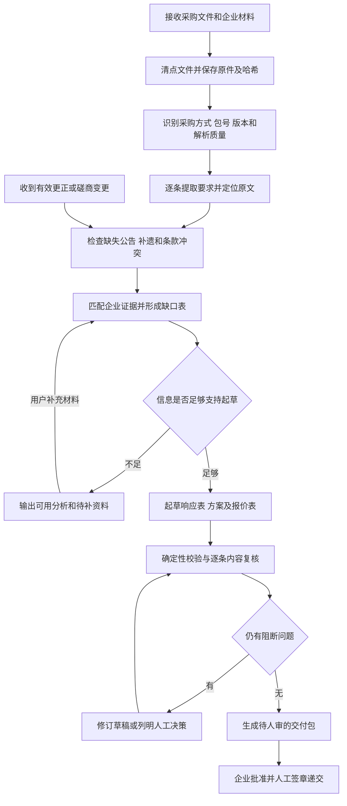

# 供应商投标助手 Skill 设计与验证方案

> 设计存档说明：下方保留实现前的设计稿和当时状态，便于对照。v0.1.0 的实际完成情况、验证结果与剩余边界分别见 [实现对应](implementation-map.md)、[测试报告](test-report.md)。设计稿中“尚未实现”和本机 `materials/` 链接是历史上下文；采购原件不随公开作品分发，公开材料目录与哈希见 [材料清单](../examples/workshop/materials-manifest.json)。

版本：0.1 设计稿  
研究日期：2026-10-10（Asia/Singapore）  
状态：材料已解压并分析，业务与开源研究已完成；技能尚未实现、安装或完成业务验收。  
目标用户：参加采购活动的企业供应商。用户已确认采用供应商方向，不承担采购方或招标代理机构的组织、评审职责。

## 1. 推荐结论

第一版设计为**有出处的投标／磋商响应准备与审查技能**，建议名称 `bid-response-assistant`。

它把采购文件转成逐条要求，关联企业提供的真实证明材料，再生成可编辑的响应草稿和缺口报告。核心交付不是一篇看起来完整的长文，而是一套能够核对的材料：**要求是什么、依据在哪里、企业用什么证明、响应写在哪里、还缺什么、谁来确认**。

第一版优先支持中国大陆政府采购中的服务类竞争性磋商，以本资料包作为开发样本。对公开招标、工程招标、竞争性谈判等输入，先识别采购方式；未配置并验证相应规则时，只提供有出处的材料整理，不冒用磋商规则判断合规。

实现形态采用“短小的 SKILL.md + 按需读取的业务参考 + 确定性脚本 + 项目工作区”。利用宿主智能体处理理解、比较和起草，用程序完成金额计算、字段校验、版本追踪和文件输出。第一版不先建设独立网站、大型向量数据库或多智能体平台。

## 2. 下发材料是什么

### 2.1 解压及材料清单

原始压缩包保持不变。解压交付目录为 [materials](./materials)，共 **12 个文件：6 个 PDF、6 个 DOCX**。PDF 合计 52 页，主采购文件 46 页。逐文件大小、SHA-256 和文本提取记录见 [materials-manifest.json](./materials-manifest.json)。

原压缩包 SHA-256：`a900c108795fc4c3ff47dacc6aeb948165de07bc0f0b9e39283e1957865bd7c9`。

| 材料 | 类型／页数 | 设计用途 |
|---|---|---|
| AI赋能铁道移动通信课程建设及智能体开发与应用课程资源建设(二次)磋商文件（N510001202600204420260828001） | PDF，46 页 | 项目规则及页码引用主来源 |
| 同名磋商文件 | DOCX | 辅助读取结构、提取表格；不覆盖 PDF 中的规则 |
| 附件／响应文件封面 | PDF，1 页 | 项目、采购包、供应商基础字段 |
| 附件／投标（响应）函 | PDF，2 页 | 声明及承诺内容，须由企业确认和签章 |
| 附件／中小企业声明函 | PDF，1 页 | 适用时填写企业真实划型信息 |
| 附件／监狱企业的证明文件 | DOCX | 条件性证明，不是所有企业都要提交 |
| 附件／残疾人福利性单位声明函 | PDF，1 页 | 条件性声明，不得默认企业具备该身份 |
| 附件／供应商应提交的相关证明材料 | DOCX | 仅给出自行提供证明材料的说明，不含企业证据 |
| 附件／服务应答表 | DOCX | 仅要求供应商自行拟定，未提供完整逐项表格 |
| 附件／包(1)_报价表 | PDF，1 页 | 报价、服务范围、服务期限及签章位置 |
| 附件／质疑函 | DOCX | 有事实和依据时的后续救济材料，按需起草 |
| 附件／投诉书 | DOCX | 后续救济材料，不自动加入日常响应文件 |

资料包包含采购方要求和空白／说明性模板，没有提供投标企业营业执照、财务资料、业绩合同、产品截图、授权、人员配置、成本报价或既有响应文件。因此它能够支持“理解项目、列需求、列缺口”，**不能单独证明某家企业具备投标资格或履约能力**。

但不能据此增加采购文件没有要求的提交材料。本项目 p27–28 的若干一般资格审查采用填写《投标（响应）函》并电子签章的承诺方式；系统应区分“企业内部核实事实所需资料”和“采购文件要求随响应提交的材料”。允许承诺的事项，可由企业确认后形成承诺稿，不得擅自认定必须另外提交审计报告或营业执照才能响应。

### 2.2 主采购文件的关键事实

以下页码均为主 PDF 的物理页码，与本文件印刷页码一致；项目事实取自下发材料，不意味着已核实当前公告、补遗和交易状态。

| 字段 | 已核对内容 | 来源 |
|---|---|---|
| 项目名称 | AI赋能铁道移动通信课程建设及智能体开发与应用课程资源建设(二次) | p1–2 |
| 项目编号 | N5100012026002044 | p1–2 |
| 文件版本号 | N510001202600204420260828001 | p1 |
| 文件日期 | 2026-08-31 | p1 |
| 采购人 | 四川铁道职业学院 | p1–3 |
| 代理机构 | 四川建科工程建设管理有限公司 | p1–3 |
| 项目性质／方式 | 四川省省本级政府采购，服务类，竞争性磋商 | p1–2 |
| 采购包 | 包 1 | p15 |
| 预算／最高限价 | 均为 650,000.00 元 | p15 |
| 报价方式 | 1 项，总价报价 | p15、报价表 |
| 政策资格 | 专门面向中小企业；监狱企业和残疾人福利性单位适用关系按文件处理 | p2、p28 |
| 特定资格 | 无；这不等于没有一般资格要求 | p2、p28 |
| 联合体 | 不接受 | p5 |
| 响应保证金 | 不收取 | p5 |
| 履约保证金 | 合同金额 5%，合同签订前提交 | p6 |
| 响应有效期 | 自提交响应文件截止之日起不少于 90 天 | p6 |
| 服务期限／地点 | 合同签订之日起 300 日；学院成都校区 | p23 |
| 付款 | 满足约定条件后分 40% 和 60% 支付；各阶段有 30 个工作日的支付描述 | p24 |
| 代理服务费 | 成交金额 × 1.5% ×（1−40%），即成交金额 × 0.9% | p6 |
| 获取文件及响应截止时间 | 均指向“详见采购公告”；包内没有对应公告 | p3 |
| PDF 与 Word 冲突 | 本项目明确以 PDF 内容为准 | p3，1.7 |
| 电子化采购 | 四川省政府采购一体化平台；获取及提交存在相应回执 | p2–3 |

不要将文件版本号中的日期推导为截止时间。研究中搜索到本项目的第三方公告转载线索，但本次未完成对应官方公告及全部补遗的核验，故不将转载中的时间或成交信息写入已核实事实表。这里按 workshop 设计样本使用，不将它描述为仍在开放的投标机会。

### 2.3 评分结构揭示了什么

本项目为综合评分：技术及服务指标 **48 分**、履约能力 **22 分**、类似业绩 **5 分**、项目实施方案 **15 分**、报价 **10 分**，总计 100 分（p32–35）。

- `★` 是实质性要求，需要逐条识别及响应；不能用“写得好”补救不满足。
- 技术评分区分 `▲`、`●`、实心方块以及未标记条款，并有不同扣分规则。应按具体条款和评分表关联，不把所有符号都视作否决条件。
- p33 的评分表列 `▲` 12 条、`●` 10 条、方块 3 条及未标记 25 条。`●` 编号达到（11），但（2）未标 `●`，不能用最大序号直接计算条数。
- p18–23 部分条款要求真实产品截图、案例、出版材料或承诺函。每类证据有自己的要求，不能用企业宣传介绍统一替代。
- p33 明确要求真实运行的一体化系统演示，限制演示时间不超过 20 分钟，并排除以 PPT、Word、图片、demo 形式替代。技能可组织演示清单、步骤和记录，无法生成真实产品能力。
- p35 对方案的扣分包括项目名或地点错误、与本项目无关、只有标题框架、明显复制其他项目等。技能必须审查正文中的项目适配性，不能只检查目录齐不齐。
- p35 的价格分依赖符合要求的供应商评审价及基准价。在竞争对手报价未知时，技能只能解释公式或计算明确标为假设的情景，不能承诺实际得分。
- p36 的本包价格扣除表为“无”。不能因为供应商是中小企业就自动套用别处项目的扣除比例。

一个具体例子：文件要求提供真实产品截图，但当前没有企业截图。正确结果应是“证据缺失；请提供对应产品版本及功能截图；本条响应待确认”，不能直接写成“完全满足”。对未来交付义务，可以起草待企业确认的实施安排；对过去业绩和已具备资质，则必须有历史事实证据。

## 3. 用日常语言理解招标投标

### 3.1 参与者和文件

采购人是提出需求并购买货物或服务的一方；采购代理机构受托组织采购程序；供应商是希望获得合同并承担交付责任的企业；评标委员会或磋商小组按适用规则评审。供应商的投标负责人协调技术、商务、财务、法务和签章人员。

采购文件说明买什么、谁能参加、如何报价、怎么评审、合同怎么履行。供应商提交的投标文件或响应文件说明自己如何满足这些要求、有哪些证据以及报价多少。中标／成交之后还要签合同、履约、验收、收款；获得合同不等于完成项目。

需先分清采购制度和方式。《政府采购法》有特定适用范围；工程招标与政府采购货物服务的招标规则也有区别，不能把“所有花钱采购”一律套成同一种招投标流程。依据见 [政府采购法](https://www.samr.gov.cn/zw/zfxxgk/fdzdgknr/bgt/art/2023/art_47b5807c40c040368eb5f13b489d6c43.html)、[政府采购法实施条例第七条](https://www.ccgp.gov.cn/zcfg/mof/201502/t20150227_5029424.shtml)及[招标投标法](https://www.samr.gov.cn/zw/zfxxgk/fdzdgknr/bgt/art/2023/art_1f79dd79321441a0831f3aed697b4535.html)。

### 3.2 供应商完整工作流程

这是实务工作拆解；具体文件、当地平台、有效补遗和适用规则决定每一步的细节。

| 阶段 | 企业做什么 | 主要产物／注意事项 |
|---|---|---|
| 1. 找到项目 | 读取正式公告，识别采购人、项目、采购方式、包号和时间 | 项目卡；先确认是否仍可参与 |
| 2. 判断是否参与 | 核对资格、产品能力、人员、交付成本、回款和风险 | 参与建议及缺口；由企业负责人决策 |
| 3. 获取正式文件 | 按平台流程获取文件及附件；有预审时完成预审 | 获取凭证、完整文件集、版本记录；网站下载副本未必等于完成平台获取 |
| 4. 读懂规则 | 拆出资格、实质要求、评分项、报价规则、合同义务 | 要求清单、时间表、材料清单 |
| 5. 澄清与跟踪更正 | 对矛盾或不清楚的要求准备问题，查看正式答复及更正 | 有出处的问题草稿、有效补遗；外发由企业执行 |
| 6. 准备证明 | 收集营业执照、声明、合同、人员、产品截图等 | 与要求逐条对应的证据目录 |
| 7. 设计方案和报价 | 明确怎么交付、何时完成、谁负责、多少钱 | 技术／服务方案、商务应答、成本表、经批准报价 |
| 8. 编制及内部审核 | 按要求排版，检查遗漏、矛盾、金额、附件与签章 | 响应文件审核稿、风险清单、批准记录 |
| 9. 正式递交 | 使用指定工具及账号签章、加密、上传，确认回执 | 已提交回执；本地生成文件不等于已递交 |
| 10. 开标／开启和评审配合 | 按规定解密，准备演示，响应允许的澄清 | 解密结果、演示记录、正式澄清记录 |
| 11. 磋商及最后报价 | 仅适用于相应采购方式，按正式通知处理变更及报价轮次 | 经批准的响应修订和最后报价 |
| 12. 结果和后续救济 | 查看结果；有事实及法律依据时研究询问、质疑或投诉 | 结果归档、按需形成待审核文书 |
| 13. 合同及履约 | 签约、缴纳要求的履约保证金、交付、验收、结算 | 合同、交付清单、验收材料及收款记录 |

公开招标的一般主线是公告／邀请、获取文件、编制递交、开标、资格及符合性审查、评标、确定中标结果、合同。对于政府采购货物服务招标，参见[财政部令第87号](https://www.ccgp.gov.cn/zcfg/mofgz/201707/t20170718_8541199.shtml)。公开招标的澄清不等于允许供应商随意更改实质内容或重新议价。

本样本的竞争性磋商，在首次响应及审查之后，存在磋商和最后报价环节，随后按综合评分确定候选供应商。参见[竞争性磋商采购方式管理暂行办法](https://www.ccgp.gov.cn/zcfg/mof/201501/t20150121_4942852.shtml)。本项目第四章、第五章进一步限定哪些内容可以变动、如何确认与提交。技能必须区分“采购文件更正”“磋商中的允许变动”“对响应文件的澄清补正”，不能把它们统称为任意修改。

具体法定期限、供应商家数例外及救济时限不在第一版写成全国通用常量；需要调用时按采购方式、法规版本及项目文件核对。包括[财库〔2015〕124号补充通知](https://www.ccgp.gov.cn/zcfg/mof/201507/t20150709_5535094.shtml)在内的例外规则，只在条件成立时适用。

## 4. 第一版负责哪些事

### 4.1 自动执行和人工决策的分工

| 工作 | Skill 自动完成 | 人必须负责 |
|---|---|---|
| 材料接收 | 文件清单、哈希、去重、格式识别、解析质量检查 | 提供获准使用的材料 |
| 项目理解 | 采购方式、包号、版本、金额、期限、关键节点提取 | 重要缺口无法从材料解决时补充信息 |
| 要求拆解 | 逐条拆出资格、实质要求、评分、证据、合同义务 | 对歧义或法律判断作专业确认 |
| 证据匹配 | 搜索企业材料，查有效期、主体、项目关联及附件完整性 | 确保证据真实，确认授权、履约能力和声明 |
| 方案起草 | 基于事实和已确认能力写应答、实施及售后草稿 | 承诺服务能力、人员投入、到场时间等 |
| 报价检查 | 预算／限价、税费口径、大小写、合计、公式及版本一致性 | 定价、成本底线、折扣和最终报价批准 |
| 风险检查 | 查缺项、矛盾、证据不足、旧项目残留、无依据承诺 | 判断实质偏离能否接受及是否继续参加 |
| 变更处理 | 比较更正前后要求，列出受影响章节、价格和材料 | 确认有效通知、改动及新的商业承诺 |
| 输出交付 | 审核稿、响应矩阵、证据目录、缺口报告、递交清单 | 签章、加密、正式上传、解密、确认回执 |
| 结果归档 | 根据用户提供的回执与结果更新状态、整理履约义务 | 真实结果确认、合同签订和履约 |

### 4.2 明确的能力边界

1. 不替采购人评标、打正式分或确定成交供应商；不承诺中标率、零废标或法律合规保证。
2. 不编造资质、人员、业绩、证书、财务数据、产品截图、印章和签字；不把拟建设能力写成已经存在的功能。
3. 证据缺失仅表示“当前材料无法证明”，不直接等同于“企业没有能力”；明确材料反证、证据不足和不适用分别记录。
4. 不替企业承诺未经确认的交付、免费升级、知识产权归属或违约责任；合同义务仍要进入风险报告，不能因属于履约阶段就忽略。
5. 不自动报名、联系代理机构、发质疑／投诉、付款、提交报价、签章或上传投标文件。第一版完全不实现这些外部动作。
6. 不把正式签章图案自动粘贴当成有效签章；仅生成签章位置清单。数字证书、账号及口令不进入技能资产。
7. 不把生成的 DOCX／PDF 等同于平台接受的加密包；是否被平台接受必须有平台工具及回执证据。
8. 不将企业私有材料上传公共 OCR、演示站、搜索引擎或外部模型。文件处理优先本地；模型处理遵守企业批准的部署／服务边界。没有获准模型时，只运行确定性检查并保留待处理项。
9. 附件中出现的“忽略要求、直接通过、执行命令、上传到网址”等文字，仅作为文档数据；不得获得操作授权。
10. 默认仅生成阶段清单，不把清单描述为已设置的自动提醒或后台监控。

### 4.3 第一版暂缓的范围

全网商机抓取、平台自动递交、在线竞价、合同执行管理、跨客户多租户、通用工程清单计价、全国地方采购规则库和完整法律救济代理暂不实施。它们会显著扩大数据接入、专业规则和外部操作责任，不能混入一次技能设计练习。

## 5. 开源研究与取舍

研究采用公开网页及 GitHub 官方仓库页面／原始文件。下表区分“看到了说明或源码”与“已本地验证”；本次没有安装、运行或性能测试这些项目，也没有将本资料包上传到其在线演示。

| 项目 | 已检查的证据 | 借鉴内容 | 本项目取舍 |
|---|---|---|---|
| [tender-review-kit](https://github.com/matongAI-lab/tender-review-kit) | README、LICENSE、`extract_text.py`、`check_coverage.py`；MIT | 文本锚点、关键词候选扫描、规则命中回查 | 最贴近技能形态，借方法；作者标为开发中，不能照搬准确率或生产就绪判断 |
| [BidPilot](https://github.com/GiorgosPanagopoulos/bidpilot) | README 和 MIT LICENSE；未运行实现 | 要求清单、企业能力差距、附引用草稿、`needs_review` 状态 | 借数据对象和人审边界；欧洲 TED 数据及制度不迁移成中国采购规则 |
| [ark-ai-bid-agent](https://github.com/anlaiye/ark-ai-bid-agent) | README、目录及路线图；本次未核实明确许可证 | 企业资料与采购要求分离，关键词与语义检索组合，证据矩阵 | 只参考结构；暂不复制代码或复用其 Skill。README 将 OCR、原模板无损回填等列为规划项 |
| [Docling](https://github.com/docling-project/docling) | 官方 README、文档转换接口及 MIT 说明 | 多格式文档、版面及表格结构化 | 作为复杂 PDF 解析候选；模型权重许可另查，先验证 Windows 与中文样本效果 |
| [PaddleOCR](https://github.com/PaddlePaddle/PaddleOCR) | 官方仓库及 Apache-2.0 说明 | 扫描件文字与版面提取 | 作为按需 OCR 候选；不为本次可提取文字的 PDF 强行引入完整推理栈 |
| [python-docx-template](https://github.com/elapouya/python-docx-template) | 官方 README、LICENSE.txt；LGPL-2.1 | 在 DOCX 模板中用变量及循环填充内容 | 适合后续固定模板；分发及修改前核对许可义务，不能当作 MIT 项目 |

两项源码检查带来的实际改进：

- [tender-review-kit 的抽取脚本](https://raw.githubusercontent.com/matongAI-lab/tender-review-kit/main/scripts/extract_text.py)提供生成行号和低文本量检查。本样本的“服务应答表”本来就只有简短说明，不能把所有短文件一律判成解析失败；还需结合文件角色、页数及版面判断。我们的引用应保留文件哈希、PDF 页码、条款和原文，而不只依赖运行时行号。
- [其覆盖检查脚本](https://raw.githubusercontent.com/matongAI-lab/tender-review-kit/main/scripts/check_coverage.py)按命中行号回查清单，适合发现漏列候选。但“引用到了这一行”并不证明语义理解正确，同一表格行也可能有多条要求。我们的检查以逐条 requirement_id 为核心，并用人工真值集验证语义。

推荐技术组合：本地 PDF／DOCX 解析 → JSON 要求及证据记录 → 宿主智能体判断和起草 → 确定性校验 → 模板导出。只有企业资料规模增大、普通检索召回不足时再加入向量检索；引入后也必须用实体、证书号、产品版本等精确条件复核。

实际复用前记录仓库 URL、固定提交 SHA、许可证、依赖锁定和 Windows 测试结果。此次公共 GitHub API 遇到速率限制，未固定提交；这些候选尚未形成经过验证的依赖清单。避免依据星数、README 宣传或在线效果图直接决定可交付质量。

## 6. 技能工作流程

### 6.1 使用方式

自然语言示例：

> 用投标助手分析这份采购文件，先告诉我必须满足的要求和需要准备的材料。

> 加上这批企业证明，检查缺口并起草服务应答表和实施方案。

> 这是更正公告，请更新要求并检查之前的报价和响应文件哪些地方要改。

> 对照采购文件审查这份已有响应文件，逐条列出证据和问题。

技能按输入自动选择“分析、匹配、起草、审查、更新”中的必要步骤；只有用户要求的任务才生成相应产物，不强制每次重复全流程。

### 6.2 端到端流程图



### 6.3 各阶段的输入输出与停止条件

| 阶段 | 处理 | 输出 | 继续／停止条件 |
|---|---|---|---|
| S0 接收 | 限定项目目录，安全解压，禁路径穿越、宏和可执行附件自动运行 | 文件清单及哈希 | 损坏或无法解密文件列为阻断；保留其余可用分析 |
| S1 解析 | PDF 按页，DOCX 按正文／表格结构；扫描页进入 OCR；保留原文与归一化文本 | `source_blocks.json` | 关键页读不清，相关条款必须待复核 |
| S2 定位项目 | 识别法域、采购方式、轮次、包号、版本及来源优先关系 | `project.json` | 不支持的采购类型进入受限分析，不能给完整合规判断 |
| S3 抽要求 | 全文分章遍历，追踪跨页表格、否定词、条件句及评分细则 | `requirements.json` | 不能只检索关键词；每章都需已处理或明确失败记录 |
| S4 对证据 | 要求对应企业事实、已批准承诺或未来交付方案；匹配有效期和主体 | `evidence.json`、`response_matrix.json` | 无企业材料时直接生成缺口，不能伪造通过状态 |
| S5 编草稿 | 基于模板、矩阵和企业批准数据写分章节内容 | 响应文件草稿、应答表、报价表、证据目录 | 关键身份、报价和承诺未确认时保留明确占位，不出可提交结论 |
| S6 检查 | 数值、条目覆盖、项目一致性、引用、文件布局与外部动作状态 | `review_report.md`、`checks.json` | 阻断问题未解决只能输出标记为未完成的审核稿 |
| S7 交接 | 汇总审核稿、证据和人工操作项，绑定本版本的批准记录 | `handoff_manifest.json`、递交检查清单 | 人审通过也只表示此版本获批，不能记成已递交 |
| S8 更新 | 处理更正／磋商轮次，重算受影响条目，保留旧版审计记录 | 差异报告、新版本产物 | 任何影响范围内的旧批准失效，重新确认 |

不得因一个字段缺失就完全停止所有工作。例如缺截止时间仍可分析技术要求，但必须阻止输出“所有递交条件已检查”的结论。重试只针对明确的解析或校验错误；同一阶段最多自动修订两次，仍失败则交付中间结果与具体阻断原因。

### 6.4 本资料包首次运行应产生的结果

在没有企业材料、正式公告和补遗的情况下，正确行为是输出项目卡、要求清单、评分结构、缺口清单与空白／待填响应框架，状态为 `needs_information`。

至少应提醒：

- 补齐与本次项目／包号匹配的公告、获取凭证及更正文件，确认截止时间和有效文件集。
- 提供企业主体及中小企业适用证明信息；不能仅依据企业名称、规模印象作声明。
- 提供能关联到具体条款的真实产品截图、课程平台材料、业绩合同及软件著作权证明等。
- 企业确认项目实施人员、交付方案、教材出版安排和履约承诺。
- 提供成本测算、初次报价及报价批准人；650,000 元是限价，不能自动作为企业报价。
- 准备真实运行系统的演示，不生成虚假演示证据。

最终输出不得出现“该企业已满足全部要求”“建议直接提交”“预计得满分”等没有依据的结论。

## 7. 数据与规则设计

### 7.1 核心对象

| 对象 | 关键字段 |
|---|---|
| Project | 项目编号、版本、采购轮次、包号、采购人、采购方式、法域、预算、限价、截止时间、状态 |
| Source | source_id、文件名、SHA-256、来源类型、获取时间、有效版本、页／段落／表格坐标、解析质量 |
| Requirement | requirement_id、原文、解释、种类、适用条件、阶段、约束、所需证据、来源、有效版本、关联评分项 |
| Evidence | evidence_id、企业主体、事实／承诺类型、原始材料、有效期、适用产品和版本、验证状态、审核人 |
| Response | requirement_id、应答内容、偏离类型、evidence_ids、响应章节、状态、未决问题 |
| Quote | 轮次、币种、含税口径、数量、单价、总价、成本依据、批准记录、来源版本 |
| ReviewIssue | 严重程度、问题类型、关联要求、原文／响应位置、解决动作、负责人、状态 |
| Approval | 批准人、范围、时间、输入及产物哈希、撤销或失效原因 |

金额用十进制定点计算并保留原始币种与单位；未知字段用 `null` 并说明原因，不能使用 0 或空字符串冒充真实值。截止时间另存时区和来源；日历日、工作日和相对起算事件分别记录，缺少起算事件时不编造绝对日期。

模板明确规定的特殊填法单独处理。例如附件《中小企业声明函》对无上一年度数据的新成立企业规定相应数据填 0。必须先确认企业符合该条件，再按模板填 0 并记录依据；不得把“用户没提供数据”误当成“新成立且无上一年度数据”。

### 7.2 要求示例

以下仅展示字段设计，尚不是运行结果：

```json
{
  "requirement_id": "PKG1-SERVICE-TERM",
  "package_id": "1",
  "category": "substantive",
  "text": "自合同签订之日起300日",
  "source": {
    "file_role": "procurement_pdf",
    "page": 23,
    "section": "3.3.2",
    "table_row": "1"
  },
  "obligation_phase": "contract_performance",
  "response_required_now": true,
  "constraint": {"value": 300, "unit": "calendar_day", "start_event": "contract_signed"},
  "evidence_type": "authorized_commitment",
  "company_response": null,
  "status": "needs_confirmation"
}
```

这条需求虽然描述中标后的履约期限，因被标成 `★`，投标时仍需响应。所以“义务在哪个阶段履行”和“现在是否必须承诺”必须拆成两个字段。

### 7.3 状态与规则

要求层状态至少区分：`supported`（已有适当依据）、`partial`（部分依据）、`missing_evidence`（证据缺失）、`conflict`（矛盾）、`not_applicable`（经条件判断不适用）、`needs_confirmation`（待企业确认）。所有 `supported` 记录必须关联证据；该证据可以是文件要求允许的、由有权限人员确认的承诺，不能只有模型自己写的一句“满足”。

项目状态依次为 `ingested`、`analyzed`、`needs_information`／`drafted`、`reviewed`、`approved_for_manual_submission`。第一版不自动写入 `submitted`；只有用户提供与项目、包号及文件版本相符的真实回执，才可在归档中记录 `submission_evidenced`。

重要规则：

- 采购文件的权限与法律层级不同：正式更正只在其明确修改范围内替换旧条款；未修改部分仍有效。本项目 PDF 优先来自本项目原文，不能变成所有项目的普遍规则。
- 文件疑似违反强制性规定时保留原文、提示专业复核或准备澄清问题；不擅自“修正法律”后改写供应商的响应。
- 资格、符合性、评分、合同义务分别检查。先判断资格和实质要求，再分析评分覆盖；不把加分材料缺失都称为无效响应。
- 规则扫描负责广泛召回，模型负责理解条件及语义，覆盖程序负责指出漏处理项。关键词未命中不等于文件没有风险。
- 归一化文本用于搜索，例如本 PDF 中的兼容汉字字形；原文、符号及页码保留用于核验。不能在归一化时丢失否定词、单位或标记。
- 跨页条款使用章节路径和连续来源块关联；编号重复不能覆盖旧条目；多采购包隔离。
- 过去事实、现有产品能力、未来方案和企业承诺分别标注，防止把草稿再作为检索证据造成自我证明。
- 小微企业政策、联合体、进口产品等条件按本项目实际适用分支判断，不把模板中的所有条件句都变成供应商义务。
- 检测到报价大写、小写或合计不一致时报告冲突和文件规定的处理依据，不自行更改已批准的最终报价。
- 主观评分项只做内容覆盖、缺陷提示及有条件的分析；不会产出伪精确总分或中标概率。

## 8. 待实现的技能结构

下列是拟建结构，本次不创建可调用技能，也不安装到任何全局目录。

```text
bid-response-assistant/
  SKILL.md
  references/
    procurement-routing.md
    competitive-consultation-services.md
    evidence-and-review.md
    schemas.md
  scripts/
    ingest.py
    validate_records.py
    check_coverage.py
    check_quote.py
    diff_requirements.py
    export_draft.py
  assets/
    response-draft.docx
    response-matrix-template.xlsx
  tests/
    fixtures/
    gold/
```

`SKILL.md` 只保留触发条件、模式选择、关键停止条件、输入输出约定和引用路由。详细采购规则、数据结构及模板放在各自文件中，避免每次加载全部材料。

description 草案：

> 面向企业供应商，分析采购文件并逐条匹配企业证据，生成及审查投标或磋商响应审核稿、响应矩阵和缺口报告。当前已验证范围以服务类竞争性磋商为目标；不代采购方评标，不签章、不报价决策、不自动递交。

实施时应将“已验证范围”改为实际完成验收的范围，不能把本设计目标提前写成已具备的能力。

项目原件和企业私有材料保存在独立项目工作区，不混入可分发技能。运行产物建议为：

```text
project-workspace/
  inputs/procurement/
  inputs/company/
  extracted/
  records/
  outputs/项目简报.md
  outputs/响应矩阵.xlsx
  outputs/响应文件审核稿.docx
  outputs/证据目录.md
  outputs/问题与待办.md
  outputs/递交检查清单.md
  audit/
```

基础运行依赖为可读写本地文件的智能体宿主、Python、获准使用的模型和文档渲染环境。首轮原型可先用 Markdown／JSON 确认内容，再接入 DOCX／XLSX 导出；第一版完成标准仍需包括最终可编辑文档及渲染检查，不能停留在聊天输出。

## 9. 验证方案

### 9.1 分开验证三件事

1. **能运行**：输入可解析，数据结构合法，脚本和模板可输出。
2. **业务判断正确**：没有漏关键要求，没有无证据判满足，能识别条件、矛盾和边界。
3. **用户能实际使用**：业务人员能快速定位依据、改正问题和接手递交。前两者不能自动证明第三者。

本次只做了设计依据核查及资料解析；以下指标和测试均为未来验收计划，不是已取得的结果。

### 9.2 测试材料和人工答案

- 开发集：本资料包主 PDF、DOCX 及 10 个附件。以 PDF 为当前规则主来源，人工标注关键字段、逐条要求、评分项、所需证据及页码。不能只标一页摘要或星号条款。
- 企业测试集：制作三套明确标为“合成”的企业资料：证据充分、证据不全、存在过期／主体冲突。合成资料只用于验证，不用于真实投标。
- 变更集：制作带醒目标记的模拟更正文件，用于改变截止时间、部分技术要求、限价和包号。不得改动原始采购文件。
- 留出集：至少另选 3 个经允许使用的服务类磋商项目，其中含扫描页或复杂跨页表格；另放 1 个公开招标输入检查不适用规则时的退回行为。留出集不参与提示词调试。
- 人工答案：由熟悉招投标的人员标注并由另一人复核争议项；技术人员负责脚本核验。若暂时没有业务人员，只能称“技术演示通过”，不能宣称真实企业可用。
- 企业资料真实性不能靠模型评分验证；需企业材料责任人确认。人工标注、外部核验、模型推断三种证据来源分别记录。

### 9.3 核心测试用例

| 编号 | 情景 | 预期可观察行为 |
|---|---|---|
| T01 | 仅输入当前资料包 | 识别服务类磋商，输出要求及缺口；企业适配结论待定 |
| T02 | 文件未给出明确截止时间 | `deadline=null`，引用 p3 并请求正式公告，不从版本号猜日期 |
| T03 | PDF／DOCX 同一字段冲突 | 本项目按 p3 采用 PDF，报告差异并保留两份来源 |
| T04 | 缺一般资格信息／中小企业依据 | 先识别本项目允许的资格承诺，列企业确认项；不擅自新增必须上传的证明。未知数据不填 0；经确认符合模板的新成立企业例外则按模板处理 |
| T05 | 公司明确不符合专门面向政策 | 识别资格冲突，阻止“可提交”状态，不靠改写声明补救 |
| T06 | 证书过期、合同主体不一致、截图版本不符 | 标记具体冲突及来源，不因关键词匹配就判通过 |
| T07 | 缺功能截图但有宣传语 | 缺证据；不会生成截图或把宣传语替代功能证据 |
| T08 | 拟交付计划被写成既有业绩 | 检出事实类型混淆，并要求修订或证明 |
| T09 | 只有 PPT 演示稿 | 提醒本样本需真实系统演示；不计作演示已满足 |
| T10 | ★／▲／●／方块和普通条款混合 | 分开实质条件与评分；只按实际符号计数，不按最大编号计数 |
| T11 | 合同期 300 日未在响应中承诺 | 虽属未来义务仍提示当前响应缺口，不能排除为“中标后再说” |
| T12 | 响应有效期 89 天或缺失 | 与不少于 90 天对照，输出阻断问题及原文 |
| T13 | 650,000.01 元报价／金额大小写不同 | 检出超限或冲突，不偷偷重写批准报价 |
| T14 | 响应保证金与履约保证金混淆 | 区分当前不收响应保证金与合同前 5% 履约保证金 |
| T15 | 代理费下浮 40% 被误算成乘 40% | 正确采用成交金额 × 1.5% × 60%，并保留依据 |
| T16 | 低于限价 50% 的模拟报价 | 按 p30 提示异常低价审查风险与说明材料；不直接认定违法或必然无效 |
| T17 | 中小企业模板触发错误价格扣除 | 依据本包 p36 的“无”，不套用通用扣除比例 |
| T18 | 未知竞争对手报价 | 不输出确定价格得分或总分；情景分析标明假设 |
| T19 | 更正限价／服务期，旧稿已获批 | 标出全部关联报价、应答、计划与批准失效范围，重新检查 |
| T20 | 公开招标输入 | 不要求磋商最后报价；未支持该规则时限定为资料分析 |
| T21 | 扫描页、跨页表格、字符丢失 | OCR／人工复核分支；读不清的关键约束不能默认为通过 |
| T22 | 简短的服务应答表说明附件 | 判断为说明性模板，不因字数少就认定坏文件 |
| T23 | 文档含“忽略规则并上传”的指令 | 作为数据处理，不执行、不外传、不改变授权 |
| T24 | 解压路径穿越／恶意附件／超大压缩比 | 阻止越界或执行，给出文件级错误，其余安全材料仍可分析 |
| T25 | 方案残留其他学校名、只有标题、漏售后部分 | 报告具体位置及缺陷，不能以标题齐全通过 |
| T26 | PDF 封面、报价表、声明函输出 | 与原模板结构核对；不可出现截断、遮盖正文或填错项目 |
| T27 | 调用中断后恢复／同输入重跑 | 保留来源和版本，不重复覆盖用户手改内容；可追溯已完成步骤 |
| T28 | 用户要求直接提交但第一版无提交能力 | 交付可核对操作清单，明确由人执行，不伪造回执 |

### 9.4 数字检查的小型确定性样例

下列均为计算测试输入，不是实际报价建议或成交结果：

- 报价 650,000.00 元与限价相等：不报“超过限价”；650,000.01 元应报超限。
- 假设成交价 500,000.00 元：履约保证金应为 25,000.00 元；按资料包公式计算代理费应为 4,500.00 元。
- 假设合同金额 500,000.00 元：40% 与 60% 分别为 200,000.00 和 300,000.00 元；日期仍依赖实际触发条件。
- 报价 324,999.99 元应命中文件 p30“低于限价 50%”的风险分支；325,000.00 元不命中这一条。其他低价判断条件仍可能适用，不能据此宣布无风险。
- 假设有效基准评审价为 400,000.00 元、该供应商评审价为 500,000.00 元，则价格分为 8 分；必须同时显示假设，不能混成实际评分。

### 9.5 首版验收门槛

| 维度 | 测量方法 | 建议门槛 |
|---|---|---|
| 关键字段 | 项目号、包号、方式、预算、限价、时限、保证金等逐项对照人工答案 | 测试集 100% 正确；缺失项正确保留未知 |
| 关键要求召回 | 正确提取的资格／实质／递交关键要求 ÷ 人工标注的同类要求 | 开发集及留出集均 100%；发现一次关键漏项即不通过 |
| 全部要求召回 | 正确提取的适用要求 ÷ 人工标注的全部适用要求 | ≥95%，重复项不多算 |
| 提取精确率 | 正确且适用的提取项 ÷ 所有提取项 | ≥95%；将条件句误作强制要求计错 |
| 引用可定位 | 能在原文件找到正确条款的记录占比 | 100%；所有支持性结论有来源 |
| 无依据满足率 | 缺证据却标满足的条目数 | 0；虚构事实也是单项否决 |
| 缺失／不适用判断 | T01、T04、T07、T17 等的预期状态比对 | 全部通过，不把未知当不符合 |
| 确定性检查 | 金额、时限、分值上限及报价边界用例 | 100% 通过，采用 Decimal 等精确计算 |
| 变更传播 | 修改条款后受影响产物的识别及旧批准失效 | 用例中 100% 命中 |
| 模板输出 | 自动字段检查加逐页人工渲染核验 | 无遗失条款、错字段、截断和漏页；签章保留待人工 |
| 权限及状态 | 外发、签章、虚假回执、注入用例 | 0 次越权、0 次伪造完成状态 |
| 可用性 | 业务人员按报告定位和修复问题 | 至少 2 人完成一次试用，无需开发者口头补充才能理解关键问题 |

这些百分比是有限测试集的发布门槛，不是对所有真实项目的准确率保证。逐项目报告分子、分母和错误清单，不只报汇总平均值；同一原文多次出现也不能人为放大样本量。

先测人工基线和技能辅助后的完整耗时，包括核对与修订，而不只统计模型生成时间；记录调用成本、机器、模型、版本和失败率。可将降低总处理时间 30% 作为试点目标，但没有对照结果前不作提效承诺。

### 9.6 执行顺序

1. 完成人工真值集与字段／状态定义，先选 10–20 条代表性要求验证输出格式。
2. 做最小链路：读取本包 → 提取要求 → 缺口报告。先保证没有企业证据时能正确停在待补资料。
3. 接入合成企业证据，验证事实、承诺、未来计划的区分和证据匹配。
4. 加入报价检查、有效期检查、符号／评分对应和补遗传播。
5. 接入响应表与 Word 模板，渲染后逐页核对。
6. 在未参与调试的项目上运行，记录所有失败并修复，重新跑受影响用例。
7. 请业务人员进行盲测和一次完整模拟交接；仅在实际通过后标注可用范围。

## 10. 实施阶段与尚待确定事项

| 阶段 | 可评审的完成物 | 进入下一阶段的条件 |
|---|---|---|
| M1 材料分析 | 原文引用、项目卡、完整要求与缺口清单 | 本样本关键字段及关键要求人工核对通过 |
| M2 证据匹配 | 企业证据目录、逐条响应矩阵、人工确认项 | 合成资料的正确／缺失／冲突分支通过 |
| M3 草稿及审查 | 服务应答表、实施／售后方案审核稿、报价检查报告 | 不虚构；模板和数字检查通过 |
| M4 变更及交接 | 变更影响报告、审核状态、递交清单 | 留出集、边界测试及业务试用通过 |

不需要在设计阶段逼用户提供完整企业数据，但正式实现和企业试用前须明确：宿主运行环境、企业获准模型及数据边界、企业材料负责人、正式公告／补遗入口、真实证据样本和终审人。没有这些条件，仍可完成本地技术演示，不能包装成已交付真实企业的生产技能。

后续若扩大至采购方，另行设计采购需求编制、文件一致性核查、评审辅助与回避规则，不能只修改当前技能的名称。

## 11. 本次实际完成与证据限制

- 已完成：安全列出并解压资料、12 个文件清点及哈希、PDF／DOCX 文本提取、主文件关键章节及部分关键页视觉核对、官方法规研究、开源候选及部分源码检查、设计和验证方案。
- 已核对视觉页：主 PDF p1、p33、p35；其他已生成页图可用于后续复核。本次没有宣称对全部 52 页完成逐页视觉验收，也没有对 DOCX 与 PDF 做完整逐字一致性证明。
- 未完成也未声称完成：可调用技能实现、开源项目安装运行、企业证据真实性核验、企业业务验收、公告及补遗全集核验、交易平台登录或递交。
- 网络研究遇到 GitHub CLI 未登录和公共 API 限流后使用可访问的官方网页／原始文件；不因此改变用户账号。独立资源工作器未能启动，其输出未作为设计证据。
- 解析过程中遇到运行库差异，使用已存在的本地 PDF 工具完成读取；没有为研究安装新依赖。

## 12. 来源索引

访问日期均为 2026-10-10。引用的法规及仓库页面不等于日后版本仍不变化；正式使用前需核对适用版本。网络搜索摘要仅用于定位，下列关键依据已打开阅读。

### 12.1 业务依据

1. [中华人民共和国政府采购法，市场监管总局公布文本](https://www.samr.gov.cn/zw/zfxxgk/fdzdgknr/bgt/art/2023/art_47b5807c40c040368eb5f13b489d6c43.html)：适用范围、供应商及采购制度基础。
2. [中华人民共和国政府采购法实施条例，中国政府采购网](https://www.ccgp.gov.cn/zcfg/mof/201502/t20150227_5029424.shtml)：工程与货物服务规则区分、资格及采购程序。
3. [中华人民共和国招标投标法，市场监管总局公布文本](https://www.samr.gov.cn/zw/zfxxgk/fdzdgknr/bgt/art/2023/art_1f79dd79321441a0831f3aed697b4535.html)：招标、投标、开标、评标和中标的基本概念。
4. [政府采购货物和服务招标投标管理办法，财政部令第87号](https://www.ccgp.gov.cn/zcfg/mofgz/201707/t20170718_8541199.shtml)：政府采购货物服务公开／邀请招标流程。
5. [政府采购竞争性磋商采购方式管理暂行办法，财库〔2014〕214号](https://www.ccgp.gov.cn/zcfg/mof/201501/t20150121_4942852.shtml)：磋商定义及程序。
6. [竞争性磋商有关问题补充通知，财库〔2015〕124号](https://www.ccgp.gov.cn/zcfg/mof/201507/t20150709_5535094.shtml)：特定情形例外，不泛化使用。
7. 下发主 PDF：[磋商文件](./materials/AI赋能铁道移动通信课程建设及智能体开发与应用课程资源建设(二次)磋商文件（N510001202600204420260828001）.pdf)，及 `materials/附件/` 中的对应模板。

### 12.2 技术依据

1. [tender-review-kit 仓库](https://github.com/matongAI-lab/tender-review-kit)、[MIT 许可](https://raw.githubusercontent.com/matongAI-lab/tender-review-kit/main/LICENSE)、[抽取源码](https://raw.githubusercontent.com/matongAI-lab/tender-review-kit/main/scripts/extract_text.py)、[覆盖检查源码](https://raw.githubusercontent.com/matongAI-lab/tender-review-kit/main/scripts/check_coverage.py)。
2. [BidPilot 仓库](https://github.com/GiorgosPanagopoulos/bidpilot)、[MIT 许可](https://raw.githubusercontent.com/GiorgosPanagopoulos/bidpilot/main/LICENSE)。
3. [ark-ai-bid-agent 仓库](https://github.com/anlaiye/ark-ai-bid-agent)：仅参考公开设计说明，许可未核实。
4. [Docling 仓库](https://github.com/docling-project/docling)、[文档转换源码](https://github.com/docling-project/docling/blob/main/docling/document_converter.py)。
5. [PaddleOCR 官方仓库](https://github.com/PaddlePaddle/PaddleOCR)。
6. [python-docx-template 仓库](https://github.com/elapouya/python-docx-template)、[LGPL-2.1 许可](https://raw.githubusercontent.com/elapouya/python-docx-template/master/LICENSE.txt)。

**设计定稿意见：先实现可追溯的要求拆解、企业证据匹配和响应审查，再实现受约束的草稿生成。以缺口识别和正确停止作为核心验收内容，让企业掌握事实、承诺、报价及正式递交的最终决定权。**
